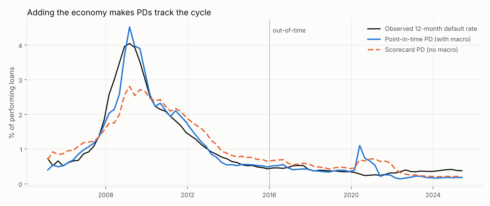
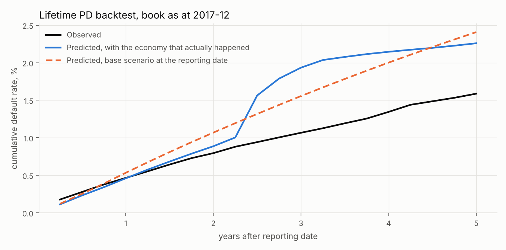

# IFRS 9 Expected Credit Loss Engine on Freddie Mac Mortgages

An end-to-end IFRS 9 impairment model of the kind bank credit-risk teams build and validate: a **12-month PD scorecard**, a **point-in-time macro layer**, **lifetime PD** from competing-risk hazards, **LGD** from actual liquidation losses, amortising **EAD**, **staging**, **probability-weighted ECL** across four scenarios, a **severe stress test**, and a full **validation pack** (discrimination, calibration, stability, out-of-time backtest).

Data: Freddie Mac's Single-Family Loan-Level Dataset (sample files, vintages 2005–2016, performance to June 2026; a random 30% of loans, about 180,000 loans and 13 million loan-months) and FRED macro series. Raw Freddie Mac files and fitted model files are excluded from this repository under Freddie Mac's terms, which allow research results to be published for noncommercial purposes provided they cannot be used to recreate any part of the dataset. Everything in `outputs/` is an aggregate result (grade-, band- or portfolio-level); no loan-level records are published.



## Results at a glance (real data)

| | |
|---|---|
| Scorecard Gini (holdout / out-of-time) | **0.80 / 0.71** |
| LightGBM challenger Gini (holdout / out-of-time) | 0.84 / 0.75: kept as challenger, see model document |
| Calibration (mean PD vs observed) | holdout 1.58% vs 1.56%; out-of-time 0.40% vs 0.39% |
| ECL at Dec 2017 | **$131.7m on $12.5bn (1.05%)**: Stage 1 0.17%, Stage 2 12.96% (4.3% of exposure), Stage 3 48.5% |
| Severe-recession stress | ECL **+51%**, Stage 2 from 4.2% to 5.4% of loans |
| Lifetime PD backtest, year 1 | **0.46% observed vs 0.46% predicted** (on the realised economy) |

## What the validation found

The model documentation ([docs/MODEL_DOCUMENTATION.md](docs/MODEL_DOCUMENTATION.md)) records eight findings in the format a bank's model validation team uses. The headline ones:

- **COVID forbearance looks like default in the raw data.** In the 2014 vintage, 74% of loan-months 90+ days past due in 2020 were in a payment holiday. The default definition excludes forbearance-driven delinquency, in line with regulators' treatment of moratoria, and puts those loans in Stage 2 instead.
- **The unemployment link broke in 2020.** Fed the actual economy, the model predicts 80% more 3-year defaults than occurred. This is why banks applied post-model adjustments (overlays) that year.
- **Recently delinquent loans are under-predicted** (grade 9: 3.5% observed vs 2.3% predicted). The fix is a segment model.
- **Since 2023, defaults have crept up while unemployment stayed low**, so PDs under-predict by about half. That points to affordability drivers the model lacks.



## Run it

1. Register (free) at Freddie Mac Clarity and download `sample_2005.zip` … `sample_2016.zip` into `data/real/raw/`. Zips are extracted automatically.
2. Download `UNRATE`, `CSUSHPISA` and `MORTGAGE30US` as CSV from FRED into `data/real/macro/`.
3. Run:

```bash
python3 -m venv .venv && source .venv/bin/activate
pip install -r requirements.txt

python scripts/run_pd.py  --data data/real --sample-frac 0.3     # 0.3 peaks at ~5 GB of RAM
python scripts/run_ecl.py --data data/real --sample-frac 0.3 --report 201712

pytest -q tests     # runs on a small synthetic sample, so no licensed data is needed
```

## How it works

```
Freddie Mac origination + monthly performance files ─┐
FRED unemployment, house prices, mortgage rates ─────┤
                                                     ▼
          quarter-end snapshots of performing loans, 12-month default flag
                                                     ▼
   WoE binning → IV → correlation filter → logistic regression (sign-checked)
                                                     ▼
        point-in-time layer: score + unemployment change + house-price growth
                                                     ▼
   quarterly default & prepayment hazards (fitted only on data before the report date)
                                                     ▼
     LGD (fractional logit on LTV)  ×  EAD (amortisation)  ×  discount
                                                     ▼
   staging (90+ DPD / 30+ DPD backstop / PD ratio)  →  ECL by scenario  →  weighted ECL
```

| Module | What it does |
|---|---|
| `src/ecl/config.py` | Freddie Mac field layouts, default definition, splits |
| `src/ecl/io.py` | Loads the pipe-delimited files and FRED CSVs (handles older `svcg` names, column-count changes) |
| `src/ecl/simulate.py` | Small synthetic sample in the exact file format, used only by the tests |
| `src/ecl/panel.py` | Snapshot panel, 12-month default flag, censoring, loan features |
| `src/ecl/scorecard.py` | Monotonic WoE binning, IV, feature selection, scorecard points |
| `src/ecl/validation.py` | Gini, KS, binomial / Jeffreys / Hosmer-Lemeshow tests, PSI |
| `src/ecl/lifetime.py` | Competing-risk hazard data and models |
| `src/ecl/lgd.py` | Realised LGD and the LGD model |
| `src/ecl/engine.py` | Scenarios, EAD, staging, ECL |
| `scripts/run_pd.py`, `scripts/run_ecl.py` | The two stages; write tables to `outputs/` and charts to `outputs/figures/` |

## Notes

- Model risk standards referenced: SR 11-7 (Federal Reserve) and SS1/23 (PRA).
- Scenario paths and weights are illustrative judgements.
- Next steps: a recently-delinquent segment PD (F1), affordability drivers (F3), a richer LGD (F5), and interaction terms to close the challenger gap (F6).
